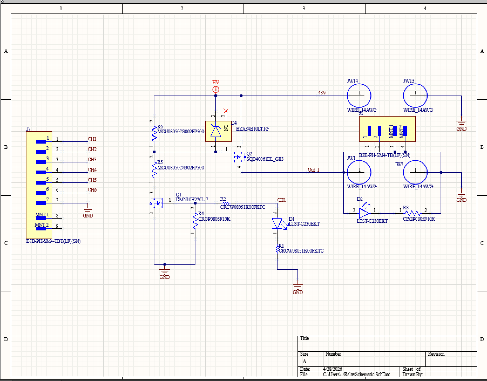

# 24V MOSFET Switching Board — Triton AI

This repository contains the Altium Designer schematic and PCB design files for a 6-channel, 24V MOSFET-based switching board developed for Triton AI, UC San Diego's autonomous racing team.

## Project Overview

The project originated from the need to replace an existing 4-channel mechanical relay module used to control electrical loads on our autonomous go-kart.

The original module served as a proof of concept but was experiencing intermittent failures. We wanted to develop a more reliable, compact, and fully integrated PCB that could provide additional switching channels.

The redesigned board replaces the mechanical relays with solid-state MOSFET switches, increases the number of channels from four to six, and reduces the overall footprint and height of the original assembly.

### Key Features

- 6 independently controlled switching channels, increased from the original 4
- 24V supply and switched outputs
- Solid-state switching using N-channel and P-channel MOSFETs
- High-side switching controlled by low-voltage microcontroller signals
- Gate-to-source Zener diode protection
- Compact, integrated PCB design
- Designed in Altium Designer

## How It Works

Each switching channel uses an N-channel MOSFET to control the gate voltage of a P-channel MOSFET.

When the microcontroller asserts the control signal, the N-channel MOSFET turns on, pulling the P-channel MOSFET's gate voltage below its source voltage. This turns on the P-channel MOSFET, connecting the 24V supply to the output.

When the control signal is deasserted, the N-channel MOSFET turns off, allowing the P-channel MOSFET's gate voltage to return toward its source voltage and disconnect the load.

A Zener diode limits the gate-to-source voltage of the P-channel MOSFET to protect it from excessive voltage.

## Testing and Integration

After PCB fabrication, the board was assembled and tested using a DC bench power supply, microcontroller control signals, and a multimeter.

Functional testing verified that the switching channels responded to their control signals and produced the expected output voltages.

The board was subsequently integrated into the autonomous go-kart, where three of its channels control the vehicle's 24V status indicator lights:

- **Red:** Emergency mode
- **Yellow:** Semi-autonomous mode
- **Green:** Autonomous mode

Integration testing confirmed that the status indicators continued functioning with the new switching board.

## Demonstration

https://youtube.com/shorts/ltIXgFceDX0

## Schematic

## Assembled PCB

